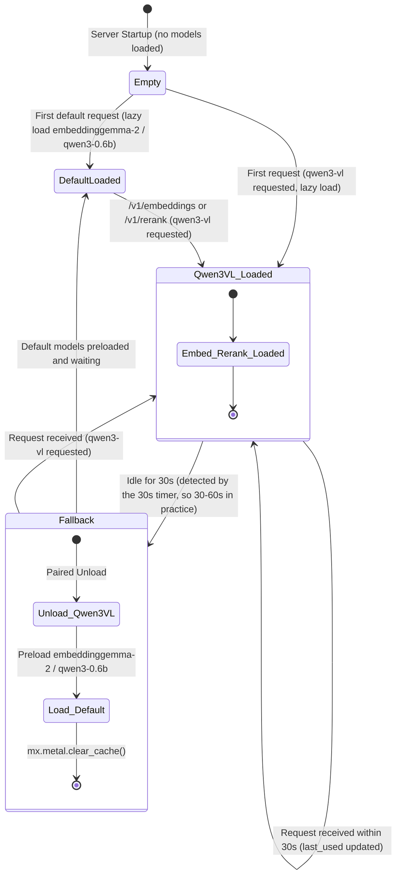
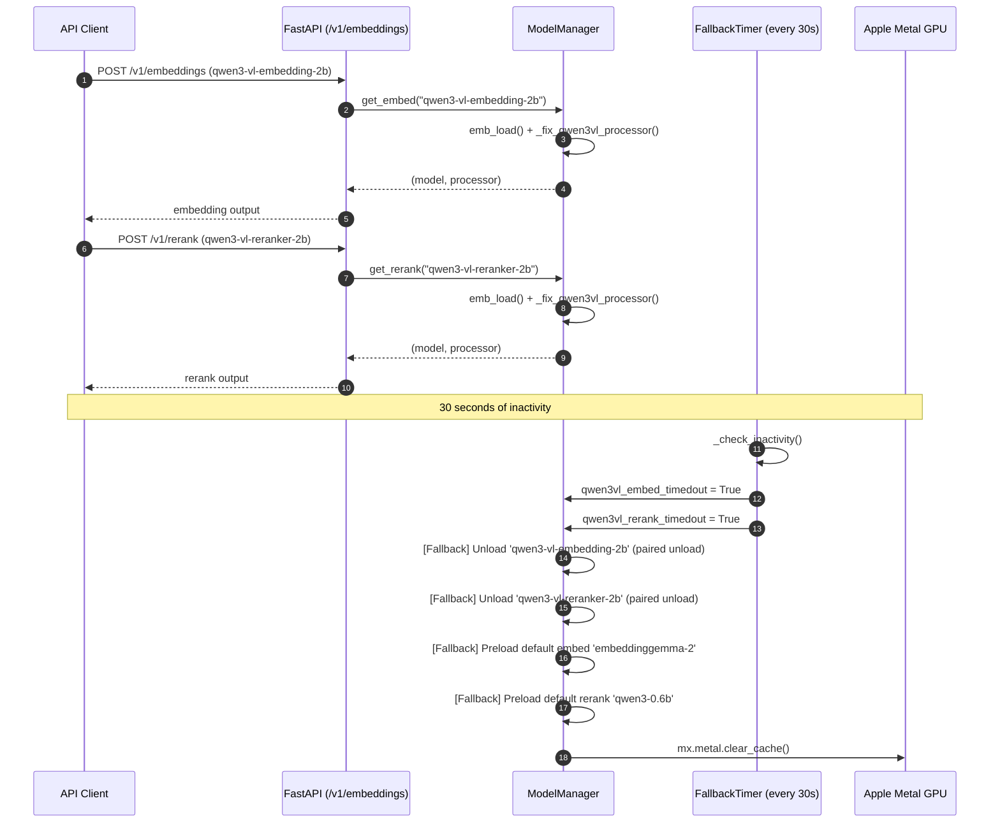

# MLX Embedding & Reranker Server

English | [日本語](README_JA.md)

A lightweight API server providing high-accuracy **Embedding**, **Reranking**, **STT** and **TTS** capabilities on a **single FastAPI process and port**, optimized with a native **MLX** backend for Apple Silicon.

It is designed to run independently from your LLM server (e.g., LM Studio, Ollama) as a dedicated **Embedding / Reranking / Audio engine** for Retrieval-Augmented Generation (RAG) workflows.

### 🚀 Default Models
The server uses the following models as defaults (used when no `model` is specified). The selection is based on the measurements in [BENCHMARK_REPORT.md](BENCHMARK_REPORT.md):
- **Embedding**: `embeddinggemma-2` (*embeddinggemma-2-bf16*, text + image)
- **Reranker**: `qwen3-0.6b` (*Qwen3-Reranker-0.6B-mxfp8*)
- **ASR (STT)**: `qwen3-asr-1.7b-8bit` (*Qwen3-ASR-1.7B-8bit*)
- **TTS**: `irodori-tts-v4.1-small-8bit` (*Irodori-TTS-v4.1-Small-8bit*)

Models are **lazily loaded on the first request** (not at startup). After a heavy multimodal Qwen3-VL model is unloaded due to inactivity, the default embedding/rerank models are automatically preloaded and kept warm.
*(Heavy multimodal models like Qwen3-VL-2B are loaded dynamically on demand and unloaded automatically.)*

---

## ✨ Features

- ✅ **Unified Process & Port**: Integrates Embedding, Reranking and Audio into a single FastAPI process (API port `1235`, dedicated health port `1236`).
- ✅ **OpenAI-Compatible API**: `/v1/embeddings`, `/v1/audio/transcriptions` and `/v1/audio/speech` follow OpenAI's request/response shapes.
- ✅ **Apple Silicon Native**: Powered by Apple's MLX library for GPU-accelerated inference on Mac hardware.
- ✅ **Multiple Models per Task**: 6 embedding models, 2 rerankers and 5 audio models selectable per request.
- ✅ **Image Embeddings**: EmbeddingGemma 2 embeds images into the same 768-d space as text (no `torch` needed), plus Matryoshka `dimensions`.
- ✅ **Multimodal Models**: Qwen3-VL Embedding/Reranker (2B) with `instruction` support (requires `torch` / `torchvision`, see [Requirements](#-requirements)).
- ✅ **Audio Capabilities**: STT (`/v1/audio/transcriptions`) and TTS with voice cloning (`/v1/audio/speech`). Two TTS engines: Qwen3-TTS and the Japanese-specialised Irodori TTS.
- ✅ **Smart Auto-Fallback**: Unloads heavy Qwen3-VL models after inactivity, clears the Metal cache and preloads the lightweight default models.
- ✅ **Hang-Resistant Supervisor**: A dedicated health server on a separate thread/port keeps responding while MLX inference blocks the main event loop.
- ✅ **Zero GGUF Overhead**: Runs directly using MLX community weights without needing GGUF conversions.
- ✅ **Ready for Integration**: Easily plugs into Open WebUI, Dify, LangChain, or custom RAG pipelines.

---

## 🧠 API Specifications

### Base URL
```
http://localhost:1235
```
A dedicated health-check server also listens on `http://localhost:1236` (see [Supervisor](#️-supervisor--auto-restart)).

> **Note:** Use `http://localhost:1235/health` for client and load-balancer health checks. Port `1236` is reserved for `run_mlx_server.sh`'s internal hang detection and should not be used externally.

### Endpoints

| Method | Path                    | Description |
|:-------|:------------------------|:------------|
| `GET`  | `/health`               | Health check, returning loaded and available models. |
| `GET`  | `/v1/models`            | Lists all available models in OpenAI list format (for client connection checks / model pickers). |
| `POST` | `/v1/embeddings`        | Generates text (and, for `embeddinggemma-2`, image) embeddings (OpenAI-compatible). |
| `POST` | `/v1/rerank` (alias `/rerank`) | Re-ranks query and document pairs. |
| `POST` | `/v1/audio/transcriptions` | Transcribes audio files to text (STT, OpenAI-compatible). |
| `POST` | `/v1/audio/speech`      | Generates speech from text (TTS, OpenAI-compatible). |

> **Note**: the only HTTP endpoint that accepts images is `/v1/embeddings` with `embeddinggemma-2`. The Qwen3-VL models are served as text-only embedding / reranking endpoints.

### `GET /health`

```json
{
  "status": "ok",
  "loaded_embed_models": [], "loaded_rerank_models": [],
  "loaded_asr_models": [], "loaded_tts_models": [],
  "available_embed": ["gemma-3-300m", "embeddinggemma-2", "qwen3-0.6b-embed"],
  "available_rerank": ["qwen3-0.6b", "qwen3-vl-reranker-2b"],
  "available_audio": ["qwen3-asr-0.6b-8bit", "qwen3-asr-1.7b-8bit", "qwen3-tts-0.6b-base-8bit", "qwen3-tts-1.7b-base-8bit",
                      "irodori-tts-v4.1-small-8bit"]
}
```

### `GET /v1/models`

Lists every model in `available_*` (loaded or not) in the OpenAI `list` shape. Each entry also carries a non-standard `type` field (`embedding` / `rerank` / `audio`).

```json
{
  "object": "list",
  "data": [
    {"id": "qwen3-0.6b", "object": "model", "created": 0, "owned_by": "mlx-embed-rerank", "type": "rerank"}
  ]
}
```

### `POST /v1/embeddings`

| Field | Type | Default | Description |
|:---|:---|:---|:---|
| `input` | `string \| (string \| image object)[]` | – (required) | What to embed. Image objects are accepted by `embeddinggemma-2` only (see below). |
| `model` | `string` | `embeddinggemma-2` | Embedding model ID. |
| `input_type` | `"query" \| "document"` | `"document"` | Selects the task prompt for `gemma-3-300m` / `embeddinggemma-2`, the query instruction for `qwen3-0.6b-embed`, and the default instruction for `qwen3-vl-embedding-2b`. |
| `instruction` | `string` | `null` | Used by `qwen3-0.6b-embed` (queries only) and `qwen3-vl-embedding-2b`. Ignored by the other models. |
| `dimensions` | `int` | `null` | Matryoshka truncation + re-normalisation for `gemma-3-300m` / `embeddinggemma-2` / `qwen3-0.6b-embed`. `400` on other models or out of range. |
| `image_tokens` | `70 \| 140 \| 280 \| 560 \| 1120` | `280` | Token budget per image (`embeddinggemma-2` only). Images are rescaled, keeping the aspect ratio, to fill the budget, so more tokens means higher resolution. Use `560` for text-heavy pages (PDF pages, slides, screenshots; `BENCHMARK_REPORT.md` §10). Ignored when the request has no images; `400` on a text-only model or for any other value. |

> **Text-heavy pages**: the same image gives a different vector at a different `image_tokens`, so keep one value per index.
> For the best accuracy, cut each page into 2×2 tiles on the client, send each tile, and score the page by its best tile;
> that beats sending the whole page at 1120 tokens (§10).

**Output vectors**: every model returns L2-normalised vectors, pooled the way the model was trained:

| Model | Pooling | Prompting |
|:---|:---|:---|
| `bge-m3` / `bge-m3-8bit` (currently disabled) | first token (CLS) | none (`input_type` ignored) |
| `gemma-3-300m` | mean pooling → 2 dense layers | query `task: search result \| query: ` / document `title: none \| text: ` |
| `embeddinggemma-2` | mean pooling | same prompts as `gemma-3-300m` (none for images) |
| `qwen3-0.6b-embed` | last token (`<\|endoftext\|>`) | queries only: `Instruct: {instruction}\nQuery:` (web-search instruction by default) |
| `qwen3-vl-embedding-2b` | delegated to `model.process()` | `instruction` |

> Before 2026-11 the server took the CLS token for every model, which left `gemma-3-300m` and `qwen3-0.6b-embed` close to useless for retrieval (JMTEB-subset nDCG@10 of 3–18; see [BENCHMARK_REPORT.md](BENCHMARK_REPORT.md) §9). **Re-index anything built with those two models before that fix.**

**Image input (`embeddinggemma-2` only)**: mix image objects into the `input` list. Vectors come back in input order and share the text space, so text→image search works.

```json
{"model": "embeddinggemma-2", "input_type": "query", "input": [
  "a person holding a red umbrella",
  {"type": "image_url", "image_url": {"url": "data:image/jpeg;base64,/9j/4AAQ..."}},
  {"type": "image", "image": "iVBORw0KGgo..."}
]}
```

- Only **base64 data URIs or raw base64** are accepted. URLs and file paths are rejected with `400`, since they would make the server fetch remote content or read local files.
- Images are processed one at a time (~140 ms each); text is batched 16 at a time.
- Text–image cosine is ~0.7 for matching pairs and ~0.5 for unrelated ones: rank with top-k rather than thresholding.

### `POST /v1/rerank` (alias `POST /rerank`)

| Field | Type | Default | Description |
|:---|:---|:---|:---|
| `query` | `string` | – (required) | Search query. |
| `documents` | `string[]` | – (required) | Candidate documents. |
| `model` | `string` | `qwen3-0.6b` | Reranker model ID. |
| `top_k` | `int` | `10` | Number of results to return. `0` returns every document. |
| `instruction` | `string` | `null` | For `qwen3-0.6b`, the `<Instruct>` text of the model card's prompt (default: `Given a web search query, retrieve relevant passages that answer the query`; the card recommends English instructions even for other languages). Also used by `qwen3-vl-reranker-2b`. |

The response contains `{"model": ..., "results": [{"index": ..., "relevance_score": ...}, ...]}` sorted by descending score. For `qwen3-0.6b` the score is P(yes) from a softmax over the `yes` / `no` logits (0–1): relevant documents score near 1, unrelated ones near 0. Documents are truncated to 1024 tokens.

> **When to use it** (`BENCHMARK_REPORT.md` §11): for text RAG, reranking the embedding top ~20 adds 1.2–5.0 nDCG@10.
> For document pages retrieved with the image+OCR hybrid, the reranker only reads the OCR text and lowers the ranking; skip it, or fuse its score 1:1 with the first stage.

### Error responses

| Situation | Endpoint | Status |
|:---|:---|:---|
| Unknown model name | all endpoints | `400` with a short detail message |
| Image on a text-only model; URL / path / broken base64 image; invalid `dimensions` or `image_tokens` | `/v1/embeddings` | `400`, checked before any model is loaded |
| Inference failure | `/v1/embeddings` | `500` with the full Python traceback in `detail` (intended for local debugging; do not expose the port publicly) |
| Inference failure | `/v1/rerank` | `500` `Internal Server Error` (no traceback; check the server log) |

---

## ⏱️ Auto-Fallback (Smart Memory Management)

To optimize unified memory on Mac hardware, heavy multimodal Qwen3-VL models (`qwen3-vl-embedding-2b` / `qwen3-vl-reranker-2b`) are **automatically unloaded once they have been idle for 30 seconds**.

- **Timer Granularity**: a repeating 30-second timer checks the idle time, so the actual release happens between 30 and 60 seconds after the last request.
- **Paired Unload**: If either model becomes inactive, both Qwen3-VL models are unloaded together to prevent resource leaks.
- **Default Preloading**: Simultaneously preloads the lightweight default models (`embeddinggemma-2` and `qwen3-0.6b`) to ensure instant availability for standard queries.
- **Immediate GPU Memory Release**: `mx.metal.clear_cache()` is called at the end of the fallback (after unloading and preloading) to free unified memory.
- **Audio models are exempt**: ASR/TTS models stay resident once loaded — the 0.6B/1.7B class is small enough that unloading was judged unnecessary.

### Model State Transition Diagram



### Fallback Sequence



---

## 🔧 Available Models (MLX)

You can select a model by passing the `model` parameter in your API request. If omitted, the default model will be loaded.

### Embedding (Default: `embeddinggemma-2`)
| Model ID | Hugging Face Model | Description / Strengths |
| :--- | :--- | :--- |
| `embeddinggemma-2` | `embeddinggemma-2-bf16` | **Default.** 768-d, embeds text and images into one space, automatic prompts, Matryoshka. Loaded with `mlx-vlm`. |
| `gemma-3-300m` | `embeddinggemma-300m-bf16` | EmbeddingGemma 300M, 768-d. **Best and fastest for text-only retrieval.** Matryoshka. |
| ~~`bge-m3`~~ | `bge-m3-mlx-fp16` | **Disabled on 2026-11-24** (HF cache removed). 1024-d, former default. |
| ~~`bge-m3-8bit`~~ | `bge-m3-mlx-8bit` | **Disabled on 2026-11-24** (HF cache removed). BGE-M3 8-bit quantized. |
| `qwen3-0.6b-embed` | `Qwen3-Embedding-0.6B-mxfp8` | Qwen3 embedding (text only, 1024-d), instruction on queries, Matryoshka. |
| `qwen3-vl-embedding-2b` | `Qwen3-VL-Embedding-2B-mxfp8` | 2B multimodal backbone, supports `instruction`; highest recall, slowest. |

### Reranker (Default: `qwen3-0.6b`)
| Model ID | Hugging Face Model | Description / Strengths |
| :--- | :--- | :--- |
| `qwen3-0.6b` | `Qwen3-Reranker-0.6B-mxfp8` | Generative cross-encoder (Yes/No logits), fast and accurate. |
| `qwen3-vl-reranker-2b` | `Qwen3-VL-Reranker-2B-mxfp8` | 2B multimodal reranking, supports `instruction`. |

### Audio (STT Default: `qwen3-asr-1.7b-8bit` / TTS Default: `irodori-tts-v4.1-small-8bit`)
| Model ID | Hugging Face Model | Description / Strengths |
| :--- | :--- | :--- |
| `qwen3-asr-0.6b-8bit` | `Qwen3-ASR-0.6B-8bit` | Speech-to-Text (ASR), fastest (65.8x realtime). |
| `qwen3-asr-1.7b-8bit` | `Qwen3-ASR-1.7B-8bit` | Speech-to-Text (ASR), best accuracy (43.9x realtime, default). |
| `qwen3-tts-0.6b-base-8bit` | `Qwen3-TTS-12Hz-0.6B-Base-8bit` | Text-to-Speech (TTS), voice cloning, fast load. |
| `qwen3-tts-1.7b-base-8bit` | `Qwen3-TTS-12Hz-1.7B-Base-8bit` | Text-to-Speech (TTS), most stable speech tempo. |
| `irodori-tts-v4.1-small-8bit` | `Irodori-TTS-v4.1-Small-8bit` | Japanese-specialised TTS: voice cloning, VoiceDesign and automatic duration in one model (default). |

Irodori has no built-in default voice equivalent to Qwen3's `voice` presets, so either `ref_audio` (voice clone) or `instruct` (VoiceDesign) is required. Omitting both returns `400` (this prevents an unconditioned, undefined-voice generation).

4-bit variants were evaluated and dropped; all shipped audio models are 8-bit. See [BENCHMARK_REPORT.md](BENCHMARK_REPORT.md) §5.6 / §6.5.
The Irodori fp16 variant (`irodori-tts-v4.1-small-fp16`) was removed: §7/§8 measurements found it indistinguishable from 8-bit on quality while consistently worse on speed, memory and disk.

**What v4.1-Small brings**

- **One checkpoint for everything**: voice cloning (`ref_audio`), VoiceDesign (`instruct`) and automatic duration prediction. Unlike v3 there is no separate base/VoiceDesign split.
- **No extra downloads**: the ModernBERT-ja-310m text encoder, its tokenizer and the Semantic-DACVAE codec all ship inside the repo.
- **Reference audio up to 120 s**: pass a list of clips and each is encoded separately then concatenated, which matches training better than one long recording. Override the budget with `max_ref_seconds`.
- **Known quirk**: for short caption-only prompts (no reference audio) the predicted duration still runs somewhat long.

---

## 🎯 Model Selection Guidance

Measured on Japanese JMTEB subsets (300 queries each, 10k-document corpora; [BENCHMARK_REPORT.md](BENCHMARK_REPORT.md) §9). nDCG@10, Spearman for JSTS:

| Model | JaGovFAQs | JAQKET | MIRACL-ja | JSTS | ms / doc | Dim |
| :--- | ---: | ---: | ---: | ---: | ---: | ---: |
| `gemma-3-300m` | **80.48** | **83.00** | **99.22** | 84.93 | **4.0** | 768 |
| `embeddinggemma-2` | 75.63 | 80.24 | 99.04 | **85.81** | 4.7 | 768 |
| `bge-m3` | 78.85 | 78.68 | 98.99 | 80.23 | 11.0 | 1024 |
| `qwen3-0.6b-embed` | 74.60 | 68.74 | 98.30 | 81.16 | 21.3 | 1024 |

Images (`embeddinggemma-2`, COCO 1k with Japanese captions): text→image R@1 72.2 / R@5 92.9, image→text R@1 84.3.

**Rule of thumb**: use `embeddinggemma-2` (the default) when images are part of the corpus, `gemma-3-300m` for the best and fastest text-only retrieval, and rerank the top 100 with `qwen3-0.6b` (~2 s for 100 documents). `bge-m3` is no longer registered, so indexes built with it must be re-embedded — changing the embedding model always means re-indexing.

---

## 📊 Performance Summary

| Task | Model | Measurement |
| :--- | :--- | :--- |
| Embedding | `embeddinggemma-2` | 1000 docs (172 chars avg) in 4.7 s (warm); ~140 ms per image |
| Rerank | `qwen3-0.6b` | top-100 in ~2.0 s (~20 ms/doc) |
| STT | `qwen3-asr-1.7b-8bit` | 32.9 s audio in 0.75 s (43.9x realtime) |
| TTS | `qwen3-tts-0.6b-base-8bit` | 2.89 s average generation (4.4x realtime); audio length varies (std≈0.54) |
| TTS | `irodori-tts-v4.1-small-8bit` | 3.96 s average (2.65 s / 5.3x at `num_steps=10`); **audio length is fully deterministic (std=0.000)** |

Full methodology, per-run numbers and accuracy comparisons: [BENCHMARK_REPORT.md](BENCHMARK_REPORT.md).

---

## 📦 Directory Structure

```text
embed_reranker/
├── mlx_embed_rerank_server.py   # Main FastAPI server (API 1235 + health 1236)
├── run_mlx_server.sh            # Supervisor / process management script
├── pyproject.toml               # Dependencies and uv configuration
├── README.md                    # Main documentation (English)
├── README_JA.md                 # Documentation in Japanese
├── GEMINI.md                    # Condensed project context for AI agents
├── BENCHMARK_REPORT.md          # Benchmark results (embedding / rerank / STT / TTS)
├── MIGRATION_SUMMARY.md         # uv & MLX migration history
├── AUTO_STARTUP_SUMMARY.md      # launchd auto-start setup
├── TTS_ENGINE_DESIGN.md         # Design of the two-engine TTS endpoint (Qwen3-TTS / Irodori)
├── PLAN_STT_TTS_REVIEW.md       # Historical design review for the audio endpoints
├── TODO.md                      # Backlog
├── LICENSE                      # MIT License
├── scripts/
│   ├── rag_pipeline_chromadb.py # End-to-end RAG benchmark against ChromaDB
│   └── benchmark_100_sentences.py
├── test-tools/                  # Ad-hoc scripts for quick tests
│   ├── test_mlx.py
│   └── test_infer.py
└── tests/                       # pytest integration suite (see tests/TEST_DESIGN.md)
    ├── TEST_DESIGN.md           # Test design: scope, cases, markers, maintenance
    ├── conftest.py              # Fixtures, markers, helpers
    ├── test_health.py           # /health (1235) + supervisor probe (1236)
    ├── test_embeddings.py       # POST /v1/embeddings
    ├── test_rerank.py           # POST /v1/rerank and /rerank
    ├── test_audio.py            # POST /v1/audio/* (marker: audio)
    ├── test_errors.py           # Error codes and request validation
    └── data/
        ├── test_cases.json      # All expected values
        └── asr_output.txt
```

---

## 🐍 Requirements

- macOS (Apple Silicon required)
- Python **3.13 (Recommended)**
- Apple MLX installed
- **ffmpeg** (for audio file processing with mp4/m4a/webm support): `brew install ffmpeg`
- **`torch` / `torchvision` for the Qwen3-VL models only.** They are *not* declared in `pyproject.toml`; without them `transformers`' `AutoImageProcessor` raises and any request for `qwen3-vl-embedding-2b` / `qwen3-vl-reranker-2b` fails with HTTP 500. Install them explicitly if you need those models:
  ```bash
  uv pip install torch torchvision
  ```
  Every other model (gemma-3-300m, embeddinggemma-2 including images, qwen3 embed/rerank, ASR, TTS) runs without them.

---

## 📥 Setup & Installation

We recommend using `uv` for seamless dependency and environment management.

### 1. Install Dependencies
```bash
uv sync
```

---

## ▶️ Running the Server

Start the server using the provided shell script:
```bash
./run_mlx_server.sh
```

Upon successful startup, the server logs:
```
Health-check server started on port 1236
Uvicorn running on http://0.0.0.0:1235
```

Management subcommands:
```bash
./run_mlx_server.sh status    # Running state + loaded models (via /health on 1235)
./run_mlx_server.sh restart
./run_mlx_server.sh kill      # Stops the process on port 1235
```

### 🛡️ Supervisor & Auto-Restart
The `run_mlx_server.sh` script runs as a foreground supervisor to ensure high availability:
- **Dedicated Health Port**: MLX inference runs synchronously and blocks uvicorn's event loop, so the server also starts a lightweight `http.server` on **port 1236** in a daemon thread. The supervisor polls `http://localhost:1236/health` — not port 1235 — so a long TTS/ASR request is never mistaken for a hang. (Background: [BENCHMARK_REPORT.md](BENCHMARK_REPORT.md) §6.6, where 10 consecutive TTS requests used to trigger spurious restarts.)
- **Health Monitoring**: Polls every 30 seconds with a 10-second curl timeout.
- **Hang Detection & Auto-Restart**: **2 consecutive failures** (a ~60-second unresponsiveness window) are treated as a hang; the supervisor kills whatever holds port 1235 and restarts the server.
- **Grace Period**: The 2-strike system prevents false positives while heavy models (like Qwen3-VL) are loading.
- **Trade-off**: because the probe lives in a separate thread of the same process, it reports `ok` whenever the process is alive. It detects a dead or wedged process, not a stuck event loop.

### Automated Startup (macOS launchd)
See [AUTO_STARTUP_SUMMARY.md](AUTO_STARTUP_SUMMARY.md). `~/Library/LaunchAgents/com.norihito.embed-reranker.plist` runs this script at login with `KeepAlive`.

---

## 🧪 Verification & Usage Examples

### Health Check
```bash
curl http://localhost:1235/health   # full status incl. loaded models
curl http://localhost:1236/health   # supervisor probe: {"status": "ok"}
```

### Generating Embeddings
```bash
curl http://localhost:1235/v1/embeddings \
  -H "Content-Type: application/json" \
  -d '{"input": "Testing embeddings", "input_type": "query"}'
```

#### With Custom Instructions (Qwen3-VL only)
```bash
curl http://localhost:1235/v1/embeddings \
  -H "Content-Type: application/json" \
  -d '{
    "model": "qwen3-vl-embedding-2b",
    "input": ["Text snippet 1", "Text snippet 2"],
    "input_type": "document",
    "instruction": "Represent this document for retrieval."
  }'
```

### Reranking Documents
```bash
curl http://localhost:1235/v1/rerank \
  -H "Content-Type: application/json" \
  -d '{
    "query": "SATA DOM recovery procedure",
    "documents": [
      "Replacing SATA DOM and reinstalling OS",
      "Increasing RAM capacity",
      "Precautions for RAID rebuild"
    ],
    "top_k": 2
  }'
```

#### Rerank with Custom Instructions (Qwen3-VL only)
```bash
curl http://localhost:1235/v1/rerank \
  -H "Content-Type: application/json" \
  -d '{
    "model": "qwen3-vl-reranker-2b",
    "query": "Cat photos",
    "documents": ["walking the dog", "sleeping cat", "flying bird"],
    "instruction": "Retrieve images or text relevant to the user'"'"'s query."
  }'
```

### Speech-to-Text (STT)
```bash
# Transcribe an audio file (wav, mp3, mp4, m4a, etc.)
curl -X POST http://localhost:1235/v1/audio/transcriptions \
  -F file="@sample.wav" \
  -F model="qwen3-asr-1.7b-8bit" \
  -F language="en"
```
The uploaded bytes are written to a temporary file under `/tmp` (preserving the original extension) and the path is handed to the model, because piping m4a/mp4 through stdin breaks ffmpeg's seek for trailing `moov` atoms. The temporary file is always removed afterwards. Response: `{"text": "..."}`.

### Text-to-Speech (TTS)
```bash
# Generate speech from text (mp3, wav, flac, ogg)
curl -X POST http://localhost:1235/v1/audio/speech \
  -H "Content-Type: application/json" \
  -d '{
    "input": "Hello, this is a test.",
    "model": "qwen3-tts-0.6b-base-8bit",
    "voice": "Chelsie",
    "response_format": "mp3"
  }' \
  --output speech.mp3
```

`response_format` maps to `audio/mpeg` (mp3), `audio/wav` (wav), `audio/flac` (flac) and `audio/ogg` (ogg); anything else falls back to `audio/mpeg`. `voice`, `speed`, `ref_audio`, `ref_text`, `lang_code` and `max_tokens` are forwarded to the model only when set (`speed` only when it differs from `1.0`, `lang_code` only when it differs from `auto`).

| Parameter | Default | Description |
|---|---|---|
| `voice` | none | Speaker name for multi-speaker models (e.g. `Chelsie`, `Ethan`) |
| `speed` | `1.0` | Speaking rate; not forwarded when it equals `1.0` |
| `lang_code` | `"auto"` | Language code (`japanese`, `english`, `chinese`, …). Anything but `auto` puts a language ID into the codec prefill |
| `max_tokens` | automatic | Generation budget; see below when omitted |

When `max_tokens` is omitted it defaults to **8192 for voice cloning (ICL)**. ICL does not split the text on `split_pattern` — it generates the whole input in a single pass — so mlx-audio's default of 4096 truncates long inputs. (The non-ICL path applies `max_tokens` *per segment*, where the default is sufficient.)

#### TTS with Voice Cloning
```bash
# Clone a voice from a reference audio file
curl -X POST http://localhost:1235/v1/audio/speech \
  -H "Content-Type: application/json" \
  -d '{
    "input": "This is a cloned voice.",
    "model": "qwen3-tts-0.6b-base-8bit",
    "ref_audio": "/path/to/reference.wav",
    "ref_text": "Reference audio transcript",
    "response_format": "wav"
  }' \
  --output cloned.wav
```

`ref_audio` must be a path **on the server host** (client-side upload is not implemented). Keep the reference clip to roughly **5–15 seconds**: longer clips make ICL encoding slow enough to matter ([BENCHMARK_REPORT.md](BENCHMARK_REPORT.md) §6.5).

#### Irodori TTS (Japanese-specialised engine)

Irodori is a separate engine from Qwen3-TTS and takes different `generate()` kwargs. It **clones from the reference audio alone — no transcript (`ref_text`) is needed**. v4.1-Small covers both cloning and VoiceDesign in one model.

```bash
# Voice cloning (no transcript required)
curl -X POST http://localhost:1235/v1/audio/speech \
  -H "Content-Type: application/json" \
  -d '{
    "input": "今日はいい天気ですね。",
    "model": "irodori-tts-v4.1-small-8bit",
    "ref_audio": "/path/to/reference.wav",
    "response_format": "wav"
  }' \
  --output cloned.wav

# VoiceDesign: describe the voice in words (no reference audio)
curl -X POST http://localhost:1235/v1/audio/speech \
  -H "Content-Type: application/json" \
  -d '{
    "input": "今日はいい天気ですね。",
    "model": "irodori-tts-v4.1-small-8bit",
    "instruct": "落ち着いた女性の声で、近い距離感でやわらかく自然に読み上げてください。",
    "response_format": "wav"
  }' \
  --output designed.wav

# Both at once: clone the voice, direct the delivery
curl -X POST http://localhost:1235/v1/audio/speech \
  -H "Content-Type: application/json" \
  -d '{
    "input": "今日はいい天気ですね。",
    "model": "irodori-tts-v4.1-small-8bit",
    "ref_audio": ["/path/to/clip1.wav", "/path/to/clip2.wav"],
    "instruct": "深く傷つき、今にも泣き出しそうな様子。声が震えており、弱々しく話す。",
    "response_format": "wav"
  }' \
  --output styled.wav
```

Passing a **list** for `ref_audio` encodes each clip separately and concatenates them (up to 120 s total, which matches training better than one long recording). Override the budget with `max_ref_seconds`.

> **⚠️ The 30-second ceiling**
> Irodori clamps the predicted length to `min_seconds`–`max_seconds` (default 0.5–30 s). To generate
> more than 30 seconds you must raise `max_seconds` explicitly; otherwise long input **saturates at
> exactly 30.00 s** ([BENCHMARK_REPORT.md](BENCHMARK_REPORT.md) §8).

**Parameter support per engine**

| Parameter | Qwen3-TTS | Irodori |
|:---|:---|:---|
| `ref_audio` (string) | ✅ ICL when paired with `ref_text` | ✅ Clones on its own |
| `ref_audio` (list) | ❌ `400` | ✅ Multi-clip reference (a v4 feature) |
| `ref_text` | ✅ Required for ICL | ⚠️ Ignored (warning logged) |
| `voice` / `lang_code` / `max_tokens` | ✅ | ⚠️ Ignored (warning logged) |
| `speed` | ✅ Passed through | ✅ Converted to `duration_scale = 1 / speed` |
| `instruct` | ❌ `400` | ✅ Voice description (always available on v4.1) |
| `seconds` | ❌ `400` | ✅ Sets the output length explicitly |
| `duration_scale` | ❌ `400` | ✅ Scales the predicted length (>1 is longer) |
| `num_steps` | ❌ `400` | ✅ Euler steps (default 40; ~6 is much faster) |
| `cfg_guidance_mode` | ❌ `400` | ✅ `independent` (default) / `alternating` (~1/3 the memory) |
| `max_ref_seconds` | ❌ `400` | ✅ Reference-audio budget (defaults to the model's 120 s) |
| `min_seconds` / `max_seconds` | ❌ `400` | ✅ Clamp range for the predicted length (default 0.5–30 s). **Long input saturates at the 30 s default** |

`voice` and `ref_text` are **ignored rather than rejected** because OpenAI-compatible clients send them unconditionally. `instruct` *is* rejected when the registered Irodori model has no caption conditioning (v2 / v3 base), since silently dropping it would not do what the caller asked; v4.1 has caption conditioning, so it always accepts `instruct`.

---

## 🧪 Automated Testing

Ensure your server is running, then execute the integration tests:

```bash
# Sync dev dependencies
uv sync --extra dev

# Run tests
uv run pytest tests/
```

Everything is an **API integration test** against the running server — nothing is mocked. The full design (scope, case list, what is deliberately *not* covered) is in [tests/TEST_DESIGN.md](tests/TEST_DESIGN.md).

| File | Covers |
| :--- | :--- |
| `tests/test_health.py` | `/health` payload, defaults, and the port-1236 supervisor probe |
| `tests/test_embeddings.py` | All 6 models: dimensions, unit norm, OpenAI envelope, default model, string vs list input, determinism, `input_type` prompts, where `instruction` applies, **4-query retrieval sanity (pooling regression guard)**, Matryoshka `dimensions`, image inputs (single, mixed-order, colour/caption match), `image_tokens` (default, other budgets, text unaffected) |
| `tests/test_rerank.py` | Both rerankers: response shape, descending order, expected winner, score range, `/rerank` alias, `top_k` (default / limit / `0` = all / oversized), empty documents, determinism, `instruction` (omitted = default text, changes the scores), **4-query retrieval sanity (prompt-format regression guard)**, long-document truncation |
| `tests/test_audio.py` | STT JSON shape, `/tmp` cleanup, TTS content-type / RIFF header / defaults, audio models staying resident |
| `tests/test_errors.py` | Unknown model → 400 on every endpoint, image / `dimensions` / `image_tokens` input errors (URLs, paths and broken base64 rejected), wrong model type, 422 validation, 404 |

Markers (registered in `pyproject.toml`, `--strict-markers` is on):

```bash
uv run pytest tests/                  # everything
uv run pytest tests/ -m "not audio"   # skip the slow STT/TTS tests
uv run pytest tests/ -m audio         # only STT/TTS
```

Notes:
- Expected values live in `tests/data/test_cases.json`. When you add or remove a model in `AVAILABLE_*_MODELS`, update `expected_embed_models` / `expected_rerank_models` / `expected_audio_models` or the `/health` assertion will fail.
- `vl`-marked tests are skipped automatically unless `torch` / `torchvision` are installed (see [Requirements](#-requirements)).
- If the server is not running, the whole suite skips instead of erroring.

---

## 💡 RAG Architecture Example

1. **Embed**: Vectorize your documents using `/v1/embeddings` with `embeddinggemma-2`.
2. **Retrieve**: Fetch the top 50–100 candidate documents from your vector database.
3. **Rerank**: Use `/v1/rerank` with `qwen3-0.6b` to narrow them down to the top 10–20 highest-quality context documents.
4. **Generate**: Pass the ranked documents as context to your LLM.

### Co-existence with LLM Servers

| Role | Port / Base URL |
| :--- | :--- |
| **LLM Server** (LM Studio / Ollama) | `http://localhost:1234/v1` |
| **Embed & Rerank Server** (this repo) | `http://localhost:1235` |
| **Supervisor-only health probe** (this repo) | `http://localhost:1236/health` |

---

## 📜 License / Credits

- **License**: MIT License (See [LICENSE](LICENSE) for details)
- Models: [mlx-community](https://huggingface.co/mlx-community) / Google / BAAI / Qwen
- Powered by [Apple MLX](https://github.com/ml-explore/mlx) and FastAPI
